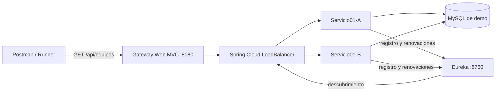

# Demostración del taller Spring Cloud LoadBalancer

Guía de la etapa 4. Ejecutar comandos PowerShell **desde la raíz del repositorio**.
Resultados efectivos y pendientes en [ESTADO.md](./ESTADO.md); alcance aprobado en
[ALCANCE.md](./ALCANCE.md). La publicación de la rama del taller fue autorizada
en Prompt 5; se conserva main sin merge.

**Actualización de cierre:** se repararon selectivamente ocho campos de acentos
del volumen existente, con [respaldo previo](./ETAPA4-ACENTOS-RESPALDO.json) y
[verificación SQL/API](./ETAPA4-ACENTOS-REPARACION.json), conservando 16 equipos,
15 partidos, IDs y demás campos. El Dashboard nuevo muestra los nombres correctos.
La colección incluye variables para No Environment y scripts con pm.variables.get.
Quince escenarios simulados y dos series Newman de doce HTTP 200/53 aserciones
pasaron, incluida compatibilidad con el entorno entregado.

**Evidencia posterior del usuario:** ejecutó manualmente el Runner y aportó
[esta captura real](./evidencias/ETAPA4-POSTMAN-RESULTADO.png), revisada sin cambios
por el agente: Liga1, carpeta 02, Source Runner, No Environment, 53 tests aprobados,
cero fallos/errores, iteración 12 y Servicio01-A=6/Servicio01-B=6.
El encabezado **Iterations: 1** contradice esas otras señales; se registra sin
inventar su causa ni alterar la captura. La configuración inicial/delay de 100 ms
no aparece y no hay segundo New Run visual capturado. Resultado y conteos están
en la misma imagen. [Procedencia y límites](./ETAPA4-POSTMAN-USUARIO.json).
Los bloqueos previos del agente quedan como históricos, separados del run del
usuario. La [guía Postman](../postman/README.md) mantiene la reproducción y las
capturas adicionales. Publicación en taller-loadbalancer solicitada por el usuario;
revisión y estado de entrega en [ESTADO.md](./ESTADO.md).

## Qué se demuestra



Eureka mantiene el registro. El Gateway usa la ruta `lb://Servicio01` y su
integración con Spring Cloud LoadBalancer para seleccionar un proceso.
**Servicio01**, no Gateway ni Postman, añade `X-Instancia` usando su mismo
`eureka.instance.instance-id`. Las dos réplicas comparten datos y contrato JSON.
La dependencia está explícita en el POM del Gateway, sin versión propia: la
gestiona el BOM del proyecto. Se conserva Gateway Server Web MVC.

Doce respuestas con ambos IDs prueban el reparto observado. No certifican mejora
de rendimiento, alternancia obligatoria, un destino inicial fijo ni reparto 6/6.
No se realizó prueba de caída: registro, renovaciones y cachés necesitan converger;
no se promete recuperación instantánea.

## Preparación, construcción y arranque

- Docker Desktop con contenedores Linux, daemon disponible, Compose y memoria
  suficiente: siete contenedores con límite de 512 MB cada uno en modo completo.
- Acceso a registros/Maven durante el primer build. Las imágenes usan Java 21;
  no hace falta instalar Java/Maven en el host para ejecutar la demo Docker.
- Puertos locales 8080, 8760, 8761 y 8764 libres; configurables en el `.env` propio.
- Postman Desktop para el Runner visual. Node/npm sólo para Newman o el auditor
  complementario. Se verificaron Node 24.15.0 y Newman 6.2.3.
- Rama de trabajo `taller-loadbalancer`. No descartar cambios ni regenerar claves
  de un volumen ya inicializado.

```powershell
git branch --show-current
git status --short
docker info --format '{{.ServerVersion}}'
docker compose version
```

**Sólo si no existe el archivo de entorno:**

```powershell
powershell -NoProfile -ExecutionPolicy Bypass -File demo-loadbalancer/scripts/New-DemoEnv.ps1
```

El script genera claves aleatorias y se niega a sobrescribir un `.env` existente.
No imprimir ni compartir ese archivo. `.env.example` contiene sólo sustitutos.

```powershell
docker compose --env-file demo-loadbalancer/.env -f demo-loadbalancer/compose.yaml --profile sistema-completo config --quiet
docker compose --env-file demo-loadbalancer/.env -f demo-loadbalancer/compose.yaml --profile sistema-completo build --parallel
```

El build usa el Wrapper de cada uno de los cinco módulos, sin POM agregador.
`package -DskipTests` acredita construcción, no ejecución de tests. Servicio01
produce `target/demo-0.0.1-SNAPSHOT.jar`. No se cambian Java 21 ni versiones de
Spring Boot/Cloud del proyecto. La etapa 2 registró cinco builds satisfactorios;
en esta auditoría se reutilizaron esas imágenes y se repitieron los tests enfocados.

**Mínimo**, cinco contenedores: MySQL, Eureka, A, B y Gateway.

```powershell
docker compose --env-file demo-loadbalancer/.env -f demo-loadbalancer/compose.yaml up -d --wait --wait-timeout 240
powershell -NoProfile -ExecutionPolicy Bypass -File demo-loadbalancer/scripts/Test-Demo.ps1 -TimeoutSeconds 180
```

**Completo**, añade Servicio02/03; usarlo para mostrar todas las vistas:

```powershell
docker compose --env-file demo-loadbalancer/.env -f demo-loadbalancer/compose.yaml --profile sistema-completo up -d --wait --wait-timeout 240
powershell -NoProfile -ExecutionPolicy Bypass -File demo-loadbalancer/scripts/Test-Demo.ps1 -FullSystem -TimeoutSeconds 180
docker compose --env-file demo-loadbalancer/.env -f demo-loadbalancer/compose.yaml --profile sistema-completo ps
```

Para pasar de completo a **sólo** mínimo, detener primero el proyecto completo con
el `down` sin `-v` indicado más abajo. Un `up` sin perfil no elimina automáticamente
los dos servicios ya activos. El mínimo prueba equipos; partidos, tabla, resumen,
portal y vistas de Servicio02/03 requieren el completo.

## Espera y comprobación previa

`healthy` no basta para acreditar descubrimiento. El verificador espera hasta
180 segundos: exige ambos registros UP y hosts internos correctos, prueba cada
réplica directamente y calienta Gateway hasta observar ambas. Después inicia una
serie nueva de doce solicitudes y prueba también `/api/equipos/{id}`.

Abrir <http://localhost:8760/>: bajo **SERVICIO01** deben verse **Servicio01-A** y
**Servicio01-B**, ambos UP. Los hosts internos son `servicio01-a` y `servicio01-b`,
puerto 8761. Los perfiles `taller-replica-a/b` son únicamente para JVM locales;
no se activan en Docker porque anuncian loopback.

Los enlaces de instancia generados por Eureka apuntan a DNS interno y a
`/actuator/info`, que no se añadió como endpoint de la demo. No usarlos como
prueba de salud desde Windows: usar la API y los puertos publicados de diagnóstico.

```powershell
Invoke-WebRequest http://localhost:8761/api/equipos -UseBasicParsing
Invoke-WebRequest http://localhost:8764/api/equipos -UseBasicParsing
Invoke-WebRequest http://localhost:8080/api/equipos -UseBasicParsing
```

Esperar A en 8761, B en 8764 y cualquiera de las dos en 8080, todos HTTP 200 y
arreglo JSON. Las llamadas directas acreditan la procedencia de la cabecera; la
serie usa **sólo** la URL del Gateway.

## Runner y procedencia de la evidencia Postman

El resultado vigente es la captura manual del usuario descrita arriba. Los relatos
de bloqueo y capturas pendientes de la auditoría inicial que siguen se conservan
como históricos; no invalidan la evidencia posterior. La tabla indica la
configuración para reproducir, incluido un delay no visible en aquella captura.

Importar la [colección actualizada](../postman/Liga1-LoadBalancer.postman_collection.json)
y verificar sus cuatro variables. Usar No Environment; el
[entorno entregado](../postman/Liga1-Local.postman_environment.json) es opcional y
sus valores activos tienen prioridad. Procedimiento detallado
y lista de capturas en la [guía Postman](../postman/README.md).

| Configuración | Valor exacto |
| --- | --- |
| Colección | Liga1 - Taller LoadBalancer |
| Carpeta | 02 - Serie de balanceo |
| Única solicitud seleccionada | GET equipos - medir reparto |
| Entorno | No Environment; opcional Liga1 - Demo local |
| `baseUrl` | http://localhost:8080 |
| `runMode` | balanceo |
| Iteraciones / delay | 12 / 100 ms |
| Datos CSV/JSON externos | Ninguno |
| Resultado | 12 HTTP 200, 53 aserciones aprobadas, cero errores/429, ambos IDs |

Cada run reinicia contadores locales en su iteración 0. Repetir como **New Run**
con la misma configuración: el total debe volver a ser doce. La última iteración
incluye las cinco aserciones agregadas y el conteo; la consola imprime
`RESUMEN_BALANCEO`. JSON inválido o cabecera ausente cuentan como error y se
incluyen en el agregado, también si ocurren en la última respuesta.

**Send individual no equivale al Runner.** Puede acreditar una respuesta HTTP,
contrato y cabecera; no documenta por sí solo doce iteraciones, contadores limpios
ni evaluación final. Usar `runMode=manual` en la carpeta de lectura para Send.

En la auditoría inicial sólo existía el informe del usuario, sin precisión sobre
Send/Runner ni capturas. Ese límite histórico se resolvió después con su confirmación
y la captura del Runner revisada arriba. Se distingue de los runs ejecutados por
el agente y se conservan la discrepancia del encabezado y los límites de configuración.

[ETAPA3-NEWMAN.json](./ETAPA3-NEWMAN.json) conserva las dos ejecuciones Newman de
la etapa 3 y la observación de Postman del agente **en aquel momento**: importación
de colección, error del panel de entornos y Runner no ejecutado por el agente.
No describe de forma global toda actividad posterior del usuario. En la interfaz
accesible durante esta auditoría se observó aún el panel de entornos con error y
un resultado abierto de otra colección; ese resultado no se usa como evidencia
de Liga1. No se borraron ni ejecutaron colecciones ajenas.

Para ampliar la evidencia disponible, conservar además una captura de configuración
y dos respuestas con A/B de **la misma URL**; resultado y agregado ya están en la
captura del usuario.
Anotar quién ejecutó la prueba, fecha y entorno. Una captura de Send o el reporte
Newman no debe rotularse como ejecución visual del Runner.

En el nuevo intento de cierre, abrir Liga1 funcionó, pero Retry/Ctrl+R mantuvieron
`Panel content couldn't load.`. El selector mostró `No Environments found.` y
Create one terminó en `Environment not found` / `We could not find the Environment
you are looking for.`. Se conserva una [captura del bloqueo](./evidencias/ETAPA4-CIERRE-POSTMAN-BLOQUEO.png),
sin atribuirle resultados del Runner. La serie Newman posterior a la reparación
volvió a aprobar doce HTTP 200 y 53 aserciones; sigue siendo complementaria.

## Filtro habitual y modo del taller

La propiedad `liga1.gateway.consecutive-limit.enabled` es true por defecto.
Sólo el perfil `taller-loadbalancer` la desactiva para permitir la serie. Se
conservan dos llamadas admitidas, tercera 429, alcance `/api/`, seguimiento por IP,
reinicio al cambiar método/URI y tras **más de** 30 segundos de inactividad.
No se cambia IP ni query para esquivarlo. El código del filtro no cambió en etapa 4.

La [guía Postman](../postman/README.md#filtro-habitual-prueba-separada-y-restauración)
incluye los comandos del override, tres solicitudes y restauración. Recrear sólo
Gateway con `compose.filtro.yaml`, esperar descubrimiento sin llamar a su API y
ejecutar carpeta **03**, `runMode=filtro`, **1 iteración**, 100 ms. Esperar
200/200/429 y diez aserciones aprobadas. Restaurar inmediatamente Compose base
sin override y `runMode=balanceo`, incluso si la prueba falla. El healthcheck de
Gateway consulta HTML y no consume el historial del filtro.

## Regresión y persistencia reproducibles

Con el sistema completo sano y en perfil del taller:

```powershell
node demo-loadbalancer/scripts/Test-Audit.cjs --output "$env:TEMP/liga1-audit-before.json"
```

El auditor valida el proyecto/volumen/puerto propios antes de escribir, crea dos
equipos y un partido con prefijo UUID exclusivo, comprueba POST/GET/PUT/DELETE,
lectura compartida A/B, resumen y recálculo de victoria/empate. Limpia en `finally`
sólo sus IDs y comprueba su prefijo antes de borrar. No elimina registros por
búsqueda global ni modifica datos iniciales. Si falla la limpieza, devuelve código
no cero e informa los IDs pendientes: no declarar limpia la base en ese caso.

La ejecución real de esta auditoría creó equipos 17/18 y partido 16, y eliminó
exactamente esos IDs con 204 y posterior 404. Los huecos del AUTO_INCREMENT son
normales; no se reinicia su contador para ocultarlos. Los datos previos se comparan
por conteos y SHA-256 de todos sus campos, no sólo por número de filas.

Para repetir la comprobación de parada/arranque **conservando datos**:

```powershell
docker compose --env-file demo-loadbalancer/.env -f demo-loadbalancer/compose.yaml --profile sistema-completo down
docker compose --env-file demo-loadbalancer/.env -f demo-loadbalancer/compose.yaml --profile sistema-completo up -d --wait --wait-timeout 240
powershell -NoProfile -ExecutionPolicy Bypass -File demo-loadbalancer/scripts/Test-Demo.ps1 -FullSystem -TimeoutSeconds 180
node demo-loadbalancer/scripts/Test-Audit.cjs --snapshot --compare "$env:TEMP/liga1-audit-before.json" --output "$env:TEMP/liga1-audit-after.json"
```

No usar `down -v`, borrar volúmenes, regenerar claves ni ejecutar manualmente el
SQL de partidos. El proyecto, la red y el volumen son exclusivos de esta demo.
Se comprobó parada completa, recreación en mínimo y ampliación a completo: mismos
16 equipos/15 partidos, hashes idénticos y cero filas de partidos duplicadas.
También se conservó ese estado al recrear MySQL con la corrección de locale.

Las rutas completas verificadas fueron `/api/partidos` (15),
`/api/tabla-posiciones` (10), `/api/partidos-resumen` (15), `/`, `/index.html`,
`/dashboard.html`, `/equipos.html`, `/registro.html`, `/tabla.html`, `/acerca.html`,
`/css/styles.css` y `/js/common.js`. Se inspeccionaron las siete vistas en navegador,
con sus datos cargados y sin errores JavaScript detectados. Las escrituras se
probaron por API; no se presenta esto como prueba de todos los botones/formularios.

## Diagnóstico y límites

| Síntoma | Comprobación / acción |
| --- | --- |
| 429 en la serie | Revisar que Gateway active `docker,taller-loadbalancer` y que no quede aplicado el override del filtro. No cambiar URL/IP para eludirlo. |
| 503 o sólo una identidad | Esperar el verificador hasta 180 s; revisar los dos registros UP, DNS/puerto anunciados y logs de Gateway/Eureka. UP no garantiza que una instancia siga viva. |
| MySQL no sano | Revisar logs de esa demo y marca `liga1-v1`; mantener las claves del volumen. No usar un reset como diagnóstico inicial. |
| HTML 200 pero faltan datos | Revisar peticiones `/api/` del navegador y modo completo. Leer cuerpo/contrato, no sólo el código HTTP. |
| Estilos ausentes | Las vistas usan una CDN externa de Tailwind. Se cargó en esta revisión, pero su disponibilidad futura no está garantizada. |
| Acentos como `César` | El volumen original se cargó con cliente latin1. `LANG=C.UTF-8` previene el problema en nuevas inicializaciones. Los ocho campos identificados del volumen actual ya se repararon con respaldo y transacción; no borrar ni reinicializar el volumen. |
| Error de entornos / importación Postman | Usar variables de colección y No Environment; verificar que la actualización se importe y Run order contenga la solicitud. Si sigue vacío o Start run deshabilitado, mantener pendiente la evidencia visual; ver guía Postman. |

```powershell
docker compose --env-file demo-loadbalancer/.env -f demo-loadbalancer/compose.yaml --profile sistema-completo logs --tail 60 eureka gateway servicio01-a servicio01-b
```

La corrección de **inicialización** UTF-8 se probó inicialmente en MySQL temporal,
sin red ni volumen persistente. Esa prueba y sus capturas históricas se conservaron.
Posteriormente, con autorización expresa del usuario para cerrar el pendiente, se
reparó el volumen existente: cinco campos de equipos y tres de partidos. Cada
valor se contrastó con un literal original de su tabla/columna, se respaldó antes
de escribir y se actualizó por ID y bytes anteriores exactos en una sola transacción.
Las guardas y la comparación completa posterior confirmaron que no cambiaron IDs,
goles, fechas, jornadas ni otros campos. Los 15 partidos siguen referenciando
nombres existentes. No se borró/reinicializó el volumen ni se insertaron datos.

El script puede inspeccionarse sin modificar datos:

```powershell
node demo-loadbalancer/scripts/Repair-DemoEncoding.cjs
```

Después de esta reparación devuelve cero campos pendientes. La ejecución con
`--apply --backup ... --report ...` ya se realizó y su respaldo no debe
sobrescribirse ni confundirse con una inicialización. Los hashes históricos
anteriores a la reparación difieren de los actuales por esos ocho cambios
autorizados; usar el [snapshot nuevo](./ETAPA4-CIERRE-DATOS.json) como referencia
posterior a la reparación, no presentar el histórico como estado actual.

## Evidencia y guion para exponer

- [ETAPA4-AUDITORIA.json](./ETAPA4-AUDITORIA.json): 107 comprobaciones, CRUD y limpieza.
- [ETAPA4-MINIMO.json](./ETAPA4-MINIMO.json) y [ETAPA4-COMPLETO.json](./ETAPA4-COMPLETO.json):
  registros, directos, doce respuestas y rutas completas.
- [ETAPA4-PERSISTENCIA.json](./ETAPA4-PERSISTENCIA.json): 23 comprobaciones,
  conteos/hashes/duplicados tras recrear contenedores.
- [ETAPA4-CHARSET.json](./ETAPA4-CHARSET.json): inicialización UTF-8 temporal.
- [ETAPA4-RESUMEN.json](./ETAPA4-RESUMEN.json): tests, Newman y revisión de navegador.
- Capturas reales: [Eureka](./evidencias/ETAPA4-EUREKA.png) y
  [Dashboard](./evidencias/ETAPA4-DASHBOARD.png). La captura de Dashboard conserva
  los acentos defectuosos observados, no se retocó para ocultarlos.
- Captura real del Runner aportada por el usuario: [resultado y conteos](./evidencias/ETAPA4-POSTMAN-RESULTADO.png); discrepancia y límites documentados arriba.
- Cierre posterior: [respaldo](./ETAPA4-ACENTOS-RESPALDO.json),
  [reparación](./ETAPA4-ACENTOS-REPARACION.json), [sistema](./ETAPA4-CIERRE-SISTEMA.json),
  [datos nuevos](./ETAPA4-CIERRE-DATOS.json) y [resumen](./ETAPA4-CIERRE.json).
- Captura vigente del [Dashboard corregido](./evidencias/ETAPA4-CIERRE-DASHBOARD.png).
  El PNG anterior se mantiene como evidencia histórica del defecto, sin retoques.

Guion breve:

1. «Esta es la misma API de equipos del proyecto. Hay dos procesos registrados con
   un mismo nombre en Eureka; sus IDs son diferentes». Mostrar Eureka.
2. «Siempre consultamos Gateway en la misma URL. Su ruta `lb://Servicio01` usa
   Spring Cloud LoadBalancer, que selecciona una de las instancias descubiertas».
3. «La instancia que respondió añadió su identidad en `X-Instancia`; el cuerpo
   conserva el contrato». Mostrar dos respuestas con A y B.
4. Ejecutar el Runner configurado y revisar su última iteración: doce válidas,
   ambas réplicas, cero errores. Si sólo se dispone de Newman, nombrarlo como tal
   y declarar pendiente la evidencia visual de Postman.
5. «El filtro habitual permite dos solicitudes y bloquea la tercera. Para esta
   demostración de reparto se desactiva mediante un perfil específico; se comprobó
   también su comportamiento habitual por separado».
6. «Los datos se comparten en MySQL y persisten al reiniciar. La prueba no mide
   rendimiento ni promete recuperación instantánea ante fallos».

Para detener al terminar, usar el `down` sin `-v` anterior. Se conserva el volumen
para la próxima revisión. La publicación de la rama pertenece a otra etapa.
